  

Hey, I'm **Sudheer**, a tech enthusiast who is always tinkering with something.

This repo contains all the details about my homelab: the hardware I've put together, how everything is powered and connected, and the self-hosted services I run day to day.

## Explore

- **[Devices](devices/):** Hardware specs, switches, power backup (solar inverter + UPS), and cables.
- **[Services](services/):** Self-hosted stacks and configs.
- **[Media](media/):** Media automation stack with Gluetun WireGuard VPN tunnel.

More services, configs, and updates are on the way.

---

  

